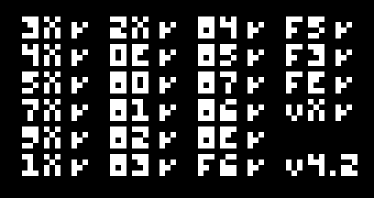
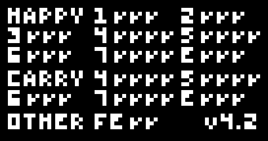

# chip8-rs

A CHIP-8 emulator written in Rust. I built it to learn Rust and low-level programming.

<p align="center">
  
  
</p>

## Why this project

CHIP-8 is a small interpreted virtual machine from the 1970s. It was first used on the COSMAC VIP and later on HP-48 calculators. It has 35 instructions, 4 KB of RAM, sixteen 8-bit registers and a 64×32 monochrome display. That makes it the usual first emulator to write: it's small enough to finish, and it still covers the core of a real machine:

- a **fetch → decode → execute** loop over 2-byte opcodes
- memory layout, a stack and a program counter
- registers, overflow and a flag register (`VF`)
- bitwise operations and XOR sprite drawing
- timers that run at 60 Hz while the CPU runs at about 700 instructions per second
- keyboard input and a window

I'm using it to learn **Rust** (ownership, fixed-size arrays vs `Vec`, wrapping integer arithmetic, `match` on opcode nibbles, error handling with `Result`, unit tests) and **low-level programming** (bit masks, memory layout, cycle timing). I also try to write the efficient version and understand why it's faster.

## Features

- All 35 standard CHIP-8 instructions, decoded into an `Instruction` enum, then executed
- 64×32 display stored as `[u64; 32]`: one row per `u64`, so a sprite row is drawn with a shift and a XOR
- 60 Hz delay and sound timers, with the CPU at 700 instructions/s spread over the frames using integer math only
- Fixed-schedule frame pacing that doesn't drift and recovers after a stall (window drag, suspend)
- The window is redrawn only when the display changed
- Error handling for unreadable ROMs, ROMs that are too large and unknown opcodes
- Unit tests for every instruction
- Quirks: COSMAC VIP shifts (`8XY6`/`8XYE` copy `VY` first) and `BNNN` (jump to `NNN + V0`); modern behavior for `FX55`/`FX65` (`I` unchanged)

## Screenshots

### Games

| Brix | Space Invaders | Pong |
|:---:|:---:|:---:|
|  |  |  |

### Demos

| Trip8 | Particles | Sierpinski |
|:---:|:---:|:---:|
|  |  |  |

### Test ROMs ([Timendus chip8-test-suite](https://github.com/Timendus/chip8-test-suite))

| IBM logo | Opcodes (corax+) | Flags |
|:---:|:---:|:---:|
|  |  |  |

The GIFs were rendered headlessly: a small program drove the `Chip8` core from this crate frame by frame, with a few scripted key presses, and dumped `display`.

## Usage

```sh
cargo run --release -- path/to/rom.ch8
```

On NixOS, `nix develop` (or `direnv allow`) gives a shell with the toolchain and the Wayland/X11 libraries that `minifb` loads at runtime.

### Keypad

The CHIP-8 hex keypad is mapped to the left side of a QWERTY keyboard:

```
CHIP-8 keypad      Keyboard
1 2 3 C            1 2 3 4
4 5 6 D            Q W E R
7 8 9 E            A S D F
A 0 B F            Z X C V
```

### Development

```sh
cargo test                              # unit tests
cargo clippy -- -W clippy::pedantic     # lint
cargo fmt                               # format
```

## Project layout

| File | Role |
|---|---|
| `src/chip8.rs` | The core: memory, registers, stack, timers, `decode` → `Instruction` → `execute`, and the tests |
| `src/frontend.rs` | The `minifb` window: converts the display to pixels, maps the keyboard |
| `src/main.rs` | The CLI and the 60 Hz main loop (CPU batch, timers, redraw, frame pacing) |
| `src/lib.rs` | The library's public API |

## How I use Claude Code

I write this project with [Claude Code](https://claude.com/claude-code) as a **tutor, not as an author**. [`CLAUDE.md`](CLAUDE.md) gives it these rules:

- **It doesn't write code in `src/`** unless I explicitly ask. It explains concepts, reviews my code and points me to the spec or the Rust feature I need.
- **Optimization matters:** when it suggests a design, it explains why it's better than the alternatives (memory layout, allocations, bounds checks, branches, what the compiler can optimize).
- It teaches idiomatic Rust as we go, and reviews with a Rust guidelines skill (`/rust-skills`).

All my conversations from this project are in [`docs/claude-sessions/`](docs/claude-sessions/), in chronological order. They show the questions I asked (how to store 4 KB of memory, how to set up the display, FX29 font sprites, timers), the code reviews, the debugging (a `minifb` window error on NixOS) and the few times I did ask it to write code, such as the unit tests for every instruction.

## References

- [Tobias V. Langhoff — Guide to making a CHIP-8 emulator](https://tobiasvl.github.io/blog/write-a-chip-8-emulator/)
- [Cowgod's CHIP-8 technical reference](http://devernay.free.fr/hacks/chip8/C8TECH10.HTM)
- [Timendus chip8-test-suite](https://github.com/Timendus/chip8-test-suite)
- [CHIP-8 program pack (Revival Studios)](https://github.com/kripod/chip8-roms): the games and demos shown above

## License

[MIT](LICENSE)
